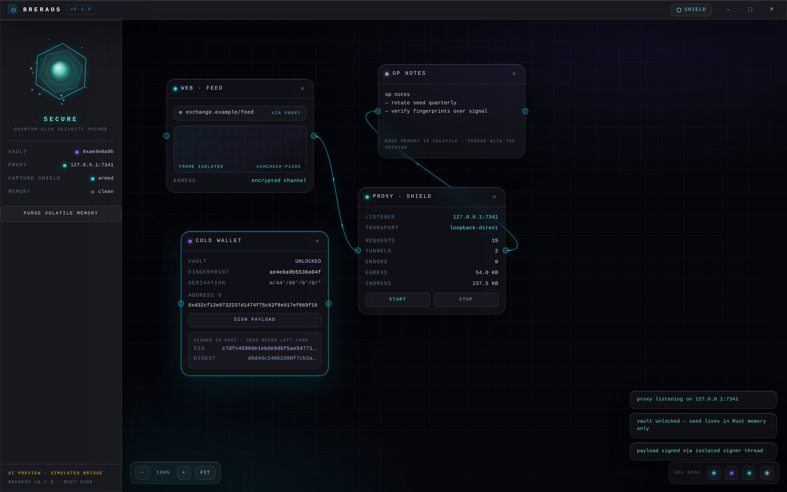
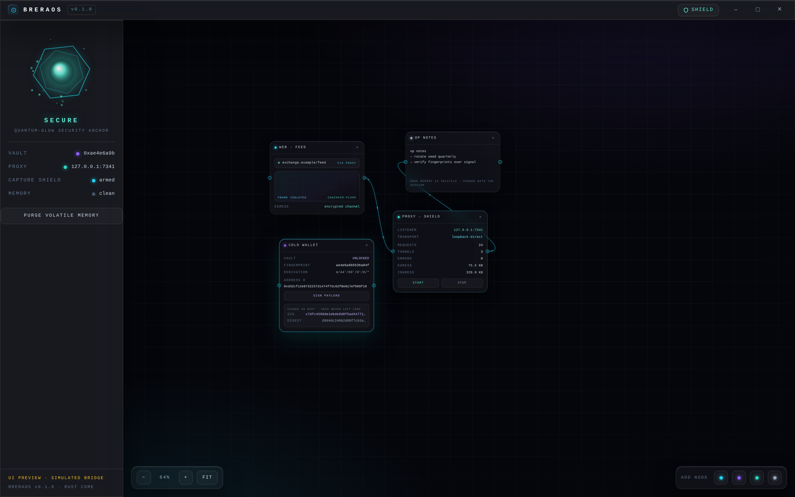
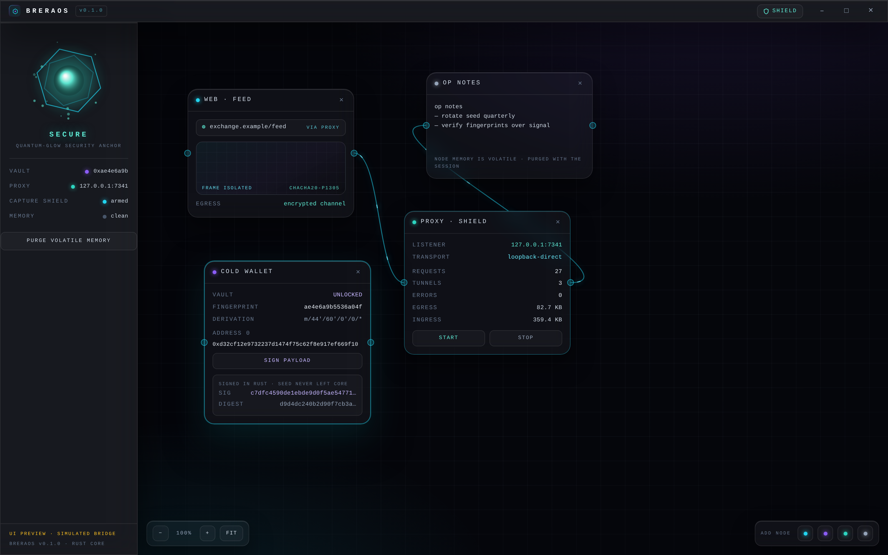
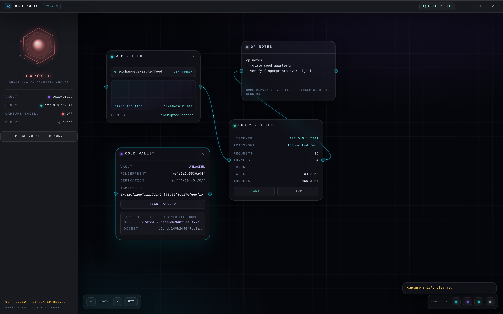

# BreraOS

A micro operating environment that lives inside Windows. Rust core.
Zero-trust glass UI. Seeds never touch the web layer.

BreraOS is not a theme and not a launcher. It is a hardened shell built
around three ideas: a **spatial canvas** instead of tabs, a **cold wallet
vault** whose keys never cross into the webview, and a **local intercept
proxy** that pushes webview traffic through an encrypted frame channel.



## why

Three attack patterns shaped this build:

| pattern | how it eats users | BreraOS answer |
|---|---|---|
| clipboard clippers | swap destination addresses mid-transaction (active campaigns through 2026, some Tor-propagated) | transactions are signed in an isolated Rust thread; the web layer only ever requests signatures |
| screen-capture stealers | grab screenshots and scrollback hunting for seed phrases | OS-level capture shield (`WDA_EXCLUDEFROMCAPTURE`) + seed that is never rendered after the write-down step |
| session/extension implants | read wallet state from the DOM | wallet state (fingerprint, addresses, receipts) is derived server-side in core; the DOM holds no derivable secret |

The spatial canvas is not decoration either. Tabs encourage background
saturation — dozens of half-read pages, all live, all attack surface.
Nodes on a canvas are deliberate: you place what you need, wire what
belongs together, and purge what you are done with.



## architecture

```
┌────────────────────────────────────────────────────────────┐
│  ui/            TypeScript · Vite · Tailwind               │
│  spatial canvas · quantum-glow anchor · glass chrome       │
│        │  invoke (typed IPC, structured errors)            │
│ ───────┼────────────────────────────────────────────────── │
│  app/           Tauri 2 shell (Rust)                       │
│  commands · state · capture shield (windows-rs)            │
│        │                                                   │
│  crates/brera-core   the wall                              │
│  ├─ wallet/   BIP-39 vault · BIP-32 m/44'/60' · EIP-55     │
│  │            signer thread: seed in, signatures out       │
│  ├─ proxy/    hyper server · XChaCha20-Poly1305 frames     │
│  │            transports: loopback (real) · p2p (stub)     │
│  └─ memguard  zeroize scrubbing · purge reports            │
└────────────────────────────────────────────────────────────┘
```

## the security model, concretely

- **Seed lifecycle.** Generated from OS entropy, shown exactly once, then
  the vault locks itself. Unlock re-parses the words (checksum verified).
  The seed lives in `Zeroizing` memory on a dedicated signer thread; drop
  wipes it. `lock` wipes it on demand and returns a purge receipt.
- **Sign, don't expose.** There is no IPC command that returns a key. The
  web layer asks `wallet_sign(payload, index)` and receives r‖s, an
  address, and a payload digest. That is the entire surface.
- **Capture shield.** On Windows the shell calls
  `SetWindowDisplayAffinity(WDA_EXCLUDEFROMCAPTURE)` on its own HWND the
  moment the window exists. Screenshots, recordings and most capture
  pipelines see nothing. One keypress disarms it — the anchor turns red.
- **Encrypted frame channel.** Every proxied request is sealed into a
  frame (XChaCha20-Poly1305, per-frame random nonce, sequence AAD) before
  it touches a transport. Flip one bit and the frame refuses to open.
  Transports are an enum: `loopback` dials the real network;
  `p2p` is a stub that fails closed until the peer layer lands.
- **No unwrap in the command path.** Core returns typed errors; the shell
  maps them to structured `{kind, message}` across IPC.



## what is real / what is stubbed

Real, tested (40 tests in core):
BIP-39 generation/parsing with checksum rejection, BIP-32 derivation to
known vectors, EIP-55 checksum encoding, signer thread lifecycle,
ECDSA sign + independent verification, vault lock/scrub semantics,
frame seal/open with tamper rejection, the full proxy: absolute-form
HTTP round-trips, CONNECT tunnels, hop-by-hop stripping, counters,
non-loopback bind refusal.

Stubbed, honestly: the `p2p` transport (fails closed, same interface),
encrypted vault-at-rest (seed is memory-only for now), and the browser
design preview (the UI runs standalone with a simulated bridge — every
screenshot with the `UI PREVIEW · SIMULATED BRIDGE` badge is that mode;
inside the shell the same UI talks to the real core).

## build

Windows (target platform):

```
cargo build --release -p brera-shell
# or iterate on the UI with hot reload:
npm --prefix ui install
cargo run -p brera-shell
```

Linux/macOS (development, UI preview):

```
npm --prefix ui install && npm --prefix ui run build   # ui, typechecked
npm --prefix ui run dev                                # design preview in a browser
cargo test -p brera-core                               # the core, all 40 tests
```

Linux shell builds need `libwebkit2gtk-4.1-dev libgtk-3-dev
libayatana-appindicator3-dev librsvg2-dev`.



## roadmap

- p2p transport: route frames through peers instead of direct dialing
- vault at rest: Argon2id + AEAD, still no plaintext keys in the web layer
- per-node egress policy (allow-list per webview node)
- integrity watchdog on the signer thread

## status

v0.1.0 — foundation. The wall between web and keys is real and tested.
Everything above it is still moving.

Unaudited. Prototype. Do not trust it with funds you cannot lose.
